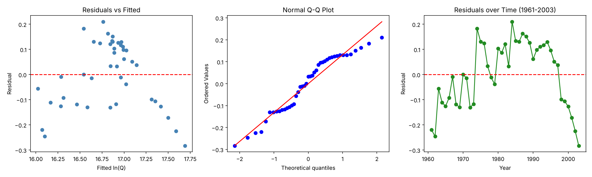
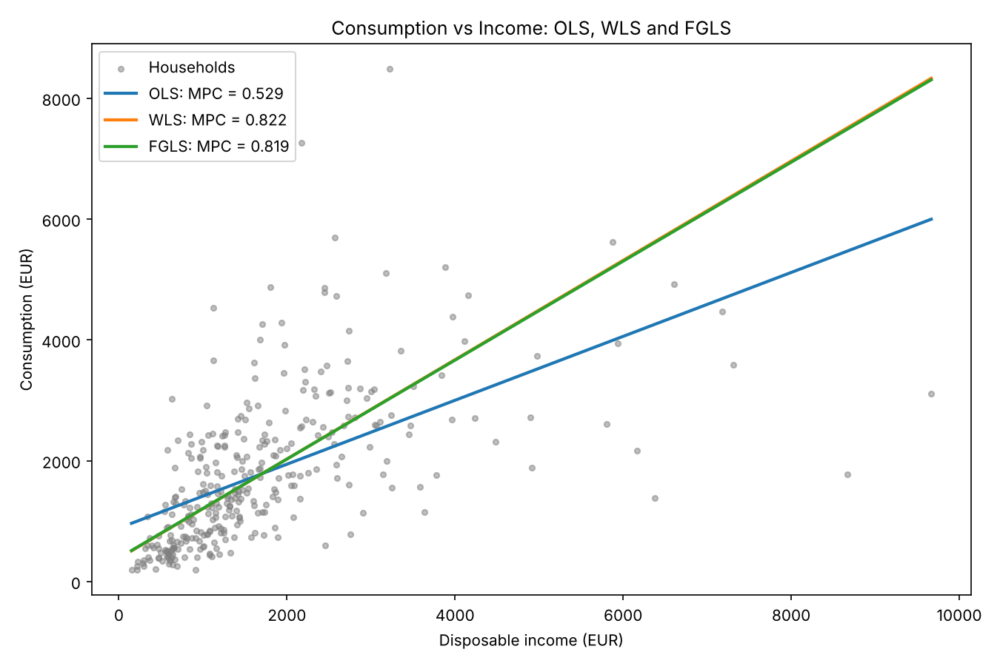
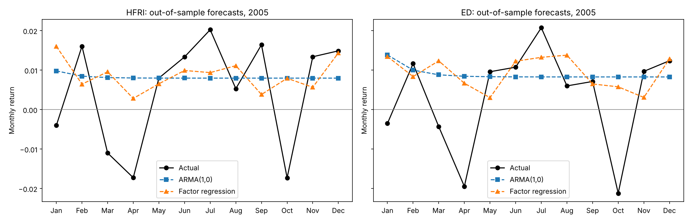

# Applied Econometrics – Regression, Heteroskedasticity & Time-Series Forecasting

Two econometrics projects in Python (`statsmodels`). They cover model specification, hypothesis testing, model selection, heteroskedasticity correction and out-of-sample forecasting of hedge fund returns.

*Academic projects – MSc Business Mathematics (NKUA & AUEB), course: Applied Econometrics. Originally completed in R; re-implemented in Python, reproducing the original results.*

---

## Project 1 – Production & consumption functions
`production_and_consumption.py`

### Part A: Cobb-Douglas production function, Greek economy 1961–2003
Log-linearised OLS: `ln Q = b0 + b1 ln K + b2 ln L + u` (43 annual observations)

| | Estimate | 90% CI |
|---|---|---|
| Capital elasticity b1 | 0.926 | [0.805, 1.047] |
| Labour elasticity b2 | 1.885 | [1.354, 2.416] |

- R² = 0.90, F = 180.6 (p < 0.001)
- **Returns to scale:** H0: b1 + b2 = 1 is rejected (t = 6.30). The data show **increasing returns to scale**.
- **Prediction intervals** (90%) for GDP at given input levels and at the sample means
- **Model selection** across 4 nested specifications: the full model wins on all three criteria (Adj. R² 0.895, AIC −47.6, BIC −42.3)
- **Residual diagnostics:** long runs of same-sign residuals point to strong positive autocorrelation, so OLS standard errors are likely understated



### Part B: Household consumption function and heteroskedasticity (326 households)

| Method | Autonomous consumption b0 | MPC b1 | 95% CI for MPC |
|---|---|---|---|
| OLS | 883.5 | 0.529 | [0.445, 0.613] |
| WLS, Var(e) = aY | 383.2 | 0.822 | [0.720, 0.924] |
| Feasible GLS, Var(e) = a0 + a1Y | 388.7 | 0.819 | [0.717, 0.921] |

- **Breusch-Pagan** (LM = 25.76, p < 0.001) and **White** (LM = 26.33, p < 0.001) both reject homoskedasticity.
- Correcting for heteroskedasticity raises the estimated MPC from 0.53 to about 0.82, so OLS badly understated it.
- **Structural differences by place of residence:** dummy variables and income interactions (urban / semi-urban / rural). Joint F-tests reject equal intercepts (p < 0.001) and equal slopes (p = 0.002). The rural MPC is significantly higher. The full model is then re-estimated with FGLS.



---

## Project 2 – Forecasting hedge fund returns
`hedge_fund_forecasting.py`

Monthly returns of the **HFRI Fund Weighted Composite** and the **Event Driven (ED)** strategy index.
Estimation sample 4/1990–12/2004 (177 months), out-of-sample test period 2005.

**Models compared**
1. **Univariate ARMA (Box-Jenkins).** A grid search over ARMA(p,q) selects **AR(1)** for both series by AIC, BIC and AICc. Persistence is φ = 0.27 for HFRI and φ = 0.31 for ED, both significant.
2. **Predictive 15-factor regression.** Y(t+1) is regressed on X(t), with factors such as equity excess returns, SMB, HML, momentum, bond and credit spreads, commodities and VIX.
3. **Regression with ARMA errors.** Durbin-Watson (1.92 / 1.87) shows no residual autocorrelation, and the error-structure search confirms white-noise errors.

**Results**

| Series | Model | AIC | BIC | MSFE 2005 | Hit ratio |
|---|---|---|---|---|---|
| HFRI | AR(1) | **−890.82** | **−881.29** | **0.000185** | 66.7% |
| HFRI | 15-factor regression | −860.30 | −806.41 | 0.000195 | 66.7% |
| ED | AR(1) | **−923.47** | **−913.95** | 0.000192 | 66.7% |
| ED | 15-factor regression | −895.46 | −841.57 | **0.000183** | 66.7% |

**Takeaways**
- The macro and market factors explain almost none of next-month variation in HFRI (Adj. R² ≈ 0), and only 4.6% for ED.
- AR(1) wins in-sample for both series. Out-of-sample, the factor model forecasts ED slightly better, which shows why in-sample fit alone is not enough for model choice.
- Both approaches call the direction of the return correctly in 8 of 12 months.



---

## How to run
```bash
pip install -r requirements.txt
# place the course data files in ./data (not redistributed here)
python production_and_consumption.py
python hedge_fund_forecasting.py
```

## Tech stack
Python · statsmodels (OLS, WLS, ARIMA, diagnostics) · pandas · NumPy · SciPy · matplotlib
